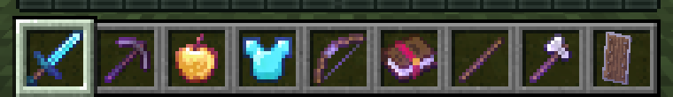
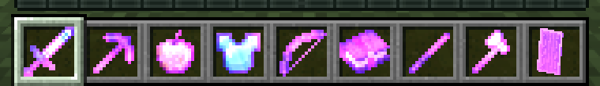
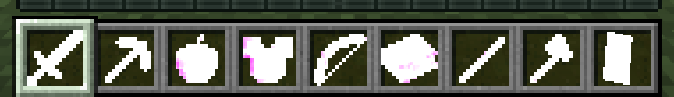
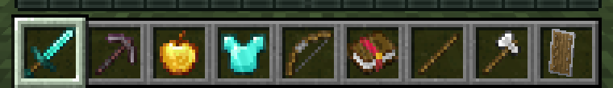
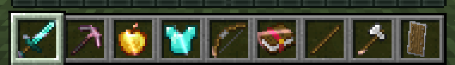
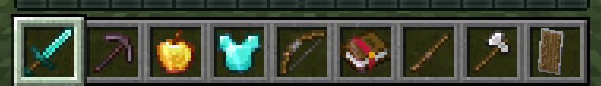
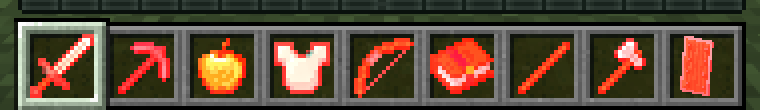
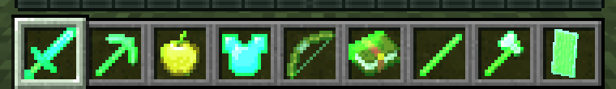
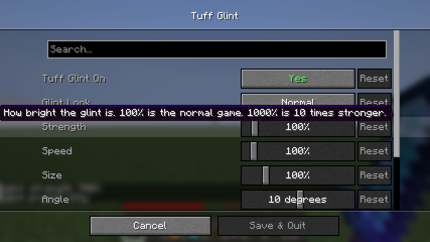

# Tuff Glint

full control of the enchantment glint. make it 10 times stronger, change speed, size, angle and color, use the glints of the HitsOnly packs or your own image, and turn it off on items or armor.

client side fabric mod for 1.21.11. settings with the menu (key **B** or mod menu, needs [Wysss Library](https://github.com/realwysss/Wysss-Library)), or with the `/tuffglint` command (needs fabric api):

- **glint look**: normal (game or resource pack glint), Aqua Pack, Hello Kitty Pack, Cry4me Pack, or my own image
- **strength**: 0% to 1000%. 100% is the normal game, 1000% is 10 times stronger
- **speed**: 10% to 1000%, on top of the glint speed in the video settings
- **size**: 25% to 400% of the glint pattern
- **angle**: the direction the glint moves in
- **tint**: recolors the glint to any color
- **items** and **armor**: show or hide the glint on each

## my own image

put `item.png` (and optionally `armor.png`) in the `config/tuffglint` folder and pick my own image. if there is no `armor.png` the item image is used for armor too. a tileable image works best, the game repeats it over the item.

## commands

- `/tuffglint` shows the settings
- `/tuffglint on` and `/tuffglint off`
- `/tuffglint strength 0-1000`, `speed 10-1000`, `size 25-400`, `angle -180-180`
- `/tuffglint preset vanilla`, `aqua`, `kitty`, `cry` or `custom`

## download

`tuff-glint-mc1.21.11-1.1.0.jar` on the releases page. minecraft 1.21.11, fabric loader 0.16 or newer, fabric api.

## pictures

normal, 300% and 1000% strength on the same items:

| normal | 300% | 1000% |
|---|---|---|
|  |  |  |

the pack glints:

| aqua | hello kitty | cry4me |
|---|---|---|
|  |  |  |

tint and my own image:

| red tint, 400% | own image |
|---|---|
|  |  |

## how it works

the glint is drawn with one texture that is moved over the item. the mod changes the strength value that goes into the glint shader, replaces the matrix that moves and scales the texture, and swaps the texture the glint is drawn with (your pick, tinted if you set a color).

all rights reserved. made by wysss.

the menu needs [Wysss Library](https://github.com/realwysss/Wysss-Library) installed.
